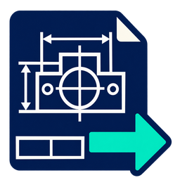
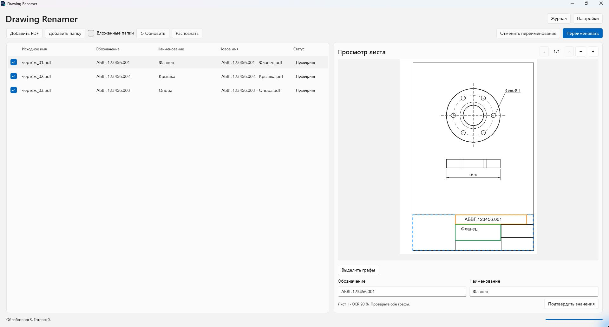

<p align="center">
  
</p>

# Drawing Renamer

Drawing Renamer пакетно переименовывает PDF-чертежи, по умолчанию по схеме `Обозначение_Наименование.pdf`, например `АБВГ.123456.001_Корпус.pdf`. Приложение извлекает данные из основной надписи ЕСКД. Стандартное наименование вида КД, например «Сборочный чертеж», опускается в распознанном поле «Наименование», в вариантах распознавания и в имени файла. Код вида входит в обозначение, если указан в штампе. Если в графе указан только вид КД, имя формируется по схеме `Обозначение.pdf`. Чтение PDF, предпросмотр и OCR выполняются локально.

Переносимая программа для Windows 10/11 x64. Архив выпуска включает .NET, Windows App SDK, Visual C++ Runtime, нативные библиотеки и модели PP-OCRv5 для русского и английского.

[Скачать для Windows](https://github.com/lfabe/DRenamer/releases/latest) · [Пример шаблона JSON](docs/template-example.json) · [Лицензии зависимостей](docs/licenses/README.md)



## <sub></sub> Быстрый старт

### Запуск готовой программы

1. Скачайте **DrawingRenamer-win-x64.zip** из раздела **Assets** последнего выпуска. [Последний выпуск](https://github.com/lfabe/DRenamer/releases/latest)
2. Распакуйте ZIP целиком в выбранную папку.
3. Откройте распакованную папку `DrawingRenamer-win-x64` и запустите `DrawingRenamer.exe`. Храните EXE вместе с остальными файлами и подпапками архива.

Все необходимые компоненты среды выполнения поставляются в архиве. Приложение готово к работе сразу после распаковки.

### Переименование PDF

1. Перетащите PDF или папки в область списка. Также можно нажать **Добавить PDF** или **Добавить папку**.
2. Отметьте документы и нажмите **Распознать**.
3. Выберите строку, проверьте лист, графы и новое имя. Для статуса **Проверить** выберите подходящий вариант или исправьте значения, затем нажмите **Подтвердить значения**. Статус **Готово** означает, что единственная пара прочитана из текста PDF и проверена по геометрии штампа.
4. Нажмите **Переименовать**, сверьте папку и новые имена, затем подтвердите операцию. По умолчанию файлы переименовываются в исходных папках. Например, имя станет `АБВГ.123456.001_Корпус.pdf`.

В графах **Обозначение** и **Наименование** допускаются прописные русские и латинские буквы, цифры `0–9`, обычный пробел, точка `.` и дефис `‒` (U+2012). В **Наименовании** также допускаются строчные русские и латинские буквы, подчёркивание `_` и знак номера `№`. Исправьте остальные символы перед подтверждением.

Флажки в строках задают состав пакета для **Распознать**, **Подтвердить** и **Переименовать**. Флажок в заголовке отмечает все файлы или снимает отметки, в том числе внутри свёрнутых групп. **Ctrl + щелчок** добавляет или снимает выделение отдельной строки. Для диапазона щёлкните первую строку, затем **Shift + щелчок** по последней.

Файлы с занятыми целевыми путями, одинаковыми целевыми именами в одной папке, уже совпадающими именами и неподтверждёнными значениями пропускаются. Обе графы должны быть заполнены, а новое имя — допустимо в Windows. Причины пропуска показаны перед выполнением операции. Если все файлы пропускаются, кнопка **Записать пропуски** сохраняет эти сведения в журнал.

В **Настройках → Разделитель имени файла** вручную введите от 1 до 3 знаков или обычных пробелов, например `_`, ` - ` или `...`. Буквы, цифры, управляющие и невидимые символы, а также запрещённые Windows знаки `< > : " / \ | ? *` не допускаются. Пробелы сохраняются точно, включая разделитель только из пробелов. Новые имена обновляются сразу. При ошибке ввода рядом с полем появляется пояснение, а переименование и сохранение настроек недоступны до исправления. По умолчанию используется `_`. Если наименование содержит только вид КД, разделитель не добавляется.

Кнопка **Сохранить** запоминает тему, разделитель, включение OCR, языки и путь к выбранному JSON с шаблонами в `%LOCALAPPDATA%\DrawingRenamer\settings.json`. При следующем запуске эти настройки загружаются автоматически. **Сбросить** возвращает системную тему, разделитель `_`, включённый OCR, русский язык и встроенные шаблоны и сразу сохраняет эти значения. Пользовательский JSON при сбросе не удаляется. Результат сохранения или ошибка отображаются в настройках. Если файл настроек повреждён, используются значения по умолчанию; если недоступен только JSON с шаблонами, остальные настройки сохраняются, а шаблоны заменяются встроенными.

Для автоматического приёма PDF откройте **Настройки**, выберите **Папка сканера** и включите **Автораспознавание сканов**. При каждом включении программа устанавливает поля **Принимать файлы, созданные с** и **Время** на текущий момент. Дату и время можно изменить вручную. Кнопка **Сохранить** запоминает папку, фильтр и состояние переключателя. В обычном режиме при включённом OCR программа сразу анализирует поступившие PDF. Выключение переключателя приостанавливает приём.

### Разбиение пачки и объединение листов

1. Включите **Разбивать пачки PDF** в настройках. При поступлении многостраничного PDF программа записывает одностраничные файлы в исходную папку. Например, из `Скан.pdf` получаются `Скан_1.pdf`, `Скан_2.pdf`. Исходник сохраняется, в очереди видны отдельные страницы.
2. Нажмите **Распознать**. Программа предложит объединить листы из одной папки с одинаковым обозначением. Раскройте строку с именем будущего PDF, чтобы увидеть листы. Документы из одного листа остаются отдельными строками.
3. Выберите предложение и проверьте порядок в правой панели. Программа сортирует листы по номеру в штампе. Если номер пропущен или повторяется, выберите соответствующую строку и исправьте **Номер листа**.
4. Нажмите **Объединить** в строке нужной группы, чтобы сохранить итоговый PDF в исходной папке. Отдельные листы сохраняются на диске. Программа проверяет версии PDF и оставляет существующие файлы на месте при совпадении имён.

Для разового разбиения PDF выберите **Разбить** в контекстном меню файла. Если лист остался отдельной строкой, перетащите его на строку группы и проверьте номер листа. Через **Убрать из группы** можно отменить ручное добавление. **Delete** и контекстное меню удаляют строку или целую группу из очереди. Файлы сохраняются на диске.

Чтобы изменить ширину столбца, потяните за правую границу заголовка или дважды щёлкните по разделителю для подгонки по содержимому. Чтобы изменить порядок столбцов, перетащите заголовок. В области просмотра **Shift + колесо** прокручивает лист по горизонтали, а **Вписать по штампу** приближает найденную или отмеченную рамку.

Кнопка **Распознать** оценивает наклон каждого листа по рамке чертежа или штампа. **Выровнять лист** доступна, если найден перекос. Нажмите её для каждого нужного листа и затем выберите **Переименовать**, чтобы записать правки в итоговый PDF. Если имя уже совпадает, выравнивание сохраняется в исходный файл. Повторное нажатие на **Выровнять лист** отменяет подготовленную правку, а **Отменить переименование** восстанавливает PDF после сохранения. Формат бумаги сохраняется. Если видимое содержимое при повороте вышло бы за края листа, программа уменьшает масштаб и показывает его в строке состояния.

**Обрезать по основной рамке** подбирает формат листа по ГОСТ 2.301-68 и показывает результат в предпросмотре. От основной рамки до края бумаги оставляются 20 мм слева и по 5 мм с остальных сторон. Обрезка допускает небольшую разницу масштаба по осям для точных полей. Проверьте формат и отметки у краёв перед переименованием или объединением, когда правка записывается в PDF.

<details>
<summary>Обновление списка, ручное распознавание, копирование и отмена</summary>

### Список и распознавание

Опция **Вложенные папки** включает рекурсивный поиск в добавленных папках. **Обновить** или **F5** перечитывает список файлов. При возврате в окно список обновляется автоматически, когда программа свободна. При обновлении и перед файловой операцией программа сверяет содержимое PDF с проверенной версией. Если PDF изменился, прежнее подтверждение сбрасывается. Нажмите **Распознать** или проверьте графы вручную.

Чтобы убрать документ из списка, выберите **Удалить из списка** в контекстном меню строки или выделите строку и нажмите **Delete**. PDF остаётся на диске. Чтобы вернуть его в список в текущем сеансе, добавьте PDF снова.

Анализ обрабатывает отмеченные документы и проверяет все страницы PDF. Подтверждённые значения сохраняются, если содержимое файла не изменилось. Для повторного анализа одного файла выберите **Распознать** в контекстном меню его строки. **Остановить анализ** прерывает обработку, сохраняя уже полученные результаты в списке. Найденные пары отображаются в **Вариантах распознавания**, в том числе единственный вариант. OCR, выбор другого варианта и редактирование полей требуют **Подтвердить значения**. Причины отказа подтверждения отображаются под полями.

Для ручного чтения откройте нужный лист, нажмите **Выделить графы**, выберите **Обозначение** и обведите первую графу. Повторите для **Наименования**. Если текст в просмотре расположен правильно, оставьте **0°**. При необходимости выберите дополнительный поворот текста по часовой стрелке относительно просмотра. Нажмите **Прочитать графы**, проверьте результат и подтвердите значения. Обе графы также можно заполнить с клавиатуры.

В **Настройках** можно включить или выключить OCR и выбрать русский, английский или оба языка. По умолчанию OCR включён и выбран русский язык. Когда русский язык включён, OCR отдаёт приоритет кириллице для букв, одинаковых по начертанию. PDF, требующие пароль для открытия, отображаются с ошибкой.

### Копирование и перемещение

Нажмите **Переименовать**, затем в диалоге подтверждения — **Выбрать папку**. Выбранная папка становится общей папкой назначения для отмеченных подтверждённых документов. Для создания копий нажмите **Скопировать**. Для перемещения включите **Удалять исходные файлы после сохранения** и нажмите **Переместить**. Кнопка **Сохранять в исходных папках** возвращает режим переименования на месте.

Папка назначения выбирается заново для каждой операции. После успешного переименования, копирования или отмены флажки у обработанных строк снимаются.

При выборе результата распознавания лист автоматически поворачивается в читаемую ориентацию. Стрелки над листом позволяют изменить поворот вручную. Опция **Сохранить поворот листов в PDF** в диалоге переименования включена по умолчанию; снимите её, чтобы сохранить исходную ориентацию PDF.

### Журнал и отмена

**Журнал** показывает результаты файловых операций, ошибки и пропуски. **Отменить переименование** при запуске недоступна. Кнопка отменяет последнюю группу успешно выполненных и ещё не отменённых действий текущего сеанса. Переименованный или перемещённый PDF возвращается на прежний путь с исходной ориентацией листов, если файл не изменился и путь свободен. Созданная копия удаляется, если исходник и копия существуют и их содержимое не изменилось.

Правки поворота, выравнивания и обрезки сохраняются в компактный PDF без встроенной предыдущей версии документа и без пересжатия изображений. При сохранении таких правок с переименованием, перемещением или заменой исходного PDF программа сохраняет оригинал для отмены в `%LOCALAPPDATA%\DrawingRenamer\Undo\<сеанс>`. При копировании в другую папку с сохранением исходника отдельная резервная копия не создаётся. Оригиналы для отмены удаляются после успешной отмены или закрытия окна; отмена после перезапуска недоступна. Если после сбоя осталось незавершённое сохранение, при следующем запуске программа проверяет исходник и результат. Неоднозначные резервные копии остаются в папке `Undo` для восстановления вручную. Резервные копии другого работающего экземпляра программы не удаляются.

Журнал сохраняет события текущего сеанса в `%LOCALAPPDATA%\DrawingRenamer\history.json`. Если запись журнала прервётся, программа остановит пакет, обновит список по фактически выполненным операциям и сохранит возможность их отмены до закрытия окна. При новом запуске программа очищает журнал. Список документов и результаты распознавания хранятся только в текущем сеансе. Настройки сохраняются между запусками кнопкой **Сохранить**.

### Диагностические логи

Приложение автоматически записывает диагностические логи в `%LOCALAPPDATA%\DrawingRenamer\Logs`. Они сохраняются между запусками отдельно от журнала отмены и содержат время UTC, уровень сообщения, операцию, пути файлов, результаты и длительность обработки, а при ошибке — исключение со стеком вызовов. Содержимое PDF и распознанные значения граф в лог не записываются.

Каждый сеанс получает отдельный UTF-8 файл `drawing-renamer-*.log` с записями JSON по одной на строку. Размер файла ограничен 2 МиБ; при достижении лимита или смене даты UTC начинается новая часть, сохраняются две предыдущие (`.log.1`, `.log.2`). Общий объём логов ограничен 20 МиБ: перед записью удаляются самые старые части. Файлы старше 7 дней удаляются при следующей записи лога; очистка выполняется и во время длительного сеанса. Необычно длинные сообщения и исключения сокращаются. Если старые файлы нельзя удалить, папка недоступна или диск заполнен, логирование пропускает запись и не прерывает работу с документами.

При сообщении об ошибке можно приложить файлы из этой папки. Перед отправкой проверьте их: пути и имена файлов могут содержать личные данные.

</details>

## <sub></sub> Разработчикам — сборка из исходников

Команды ниже предназначены для разработки и подготовки собственного выпуска. Проверенная среда сборки — Windows x64, .NET SDK 10 и Visual Studio с поддержкой .NET 10. Для клонирования репозитория используется Git. [Git](https://git-scm.com/downloads/win) · [.NET SDK 10](https://dotnet.microsoft.com/download/dotnet/10.0) · [Visual Studio](https://visualstudio.microsoft.com/downloads/)

Клонируйте репозиторий и выполните команды в PowerShell. Первый restore получает зависимости из NuGet. Языковые модели входят в репозиторий. Для сборки тестового проекта установите Python 3 и зависимости ниже. Синтетические PDF создаются при сборке тестов в `obj`.

```powershell
git clone https://github.com/lfabe/DRenamer.git
cd DRenamer
python -m pip install Pillow pypdf fonttools
dotnet restore DrawingRenamer.slnx --locked-mode
dotnet build DrawingRenamer.slnx -c Release --no-restore
dotnet test tests/DrawingRenamer.Tests -c Release --no-build
```

Для работы в Visual Studio откройте `DrawingRenamer.slnx` и выберите проект `DrawingRenamer`.

### Создание собственного ZIP-выпуска

Скрипт `Publish.ps1` публикует приложение вместе со средой выполнения, моделями OCR, документацией и лицензиями в `artifacts/DrawingRenamer-win-x64`. Он также копирует `msvcp140.dll`, `msvcp140_1.dll`, `vcruntime140.dll` и `vcruntime140_1.dll` из каталога `Microsoft.VC143.CRT` для x64. Поиск этого каталога использует Visual Studio с установленным компонентом MSVC v143.

Выполните из корня репозитория. Команда `pwsh` использует PowerShell 7. [Установка PowerShell](https://learn.microsoft.com/powershell/scripting/install/installing-powershell-on-windows)

```powershell
pwsh -NoProfile -File .\Publish.ps1
Compress-Archive -Path .\artifacts\DrawingRenamer-win-x64 -DestinationPath .\artifacts\DrawingRenamer-win-x64.zip -Force
```

Первая команда создаёт папку выпуска, вторая упаковывает её в ZIP. Если автоматический поиск Visual C++ Runtime не сработал, передайте `Publish.ps1` путь к каталогу `Microsoft.VC143.CRT` для x64 через параметр `-VcRedistDirectory`. Параметр `-Output` позволяет изменить папку публикации.

Минимальная версия Windows, заданная в проекте, — `10.0.19041` (Windows 10 2004). При выборе системы для эксплуатации учитывайте также список редакций и версий Windows, поддерживаемых .NET 10. [Поддерживаемые ОС для .NET 10](https://github.com/dotnet/core/blob/main/release-notes/10.0/supported-os.md)

## <sub></sub> Шаблоны

Программа ищет основные надписи форм 1, 2, 2а и 2б по ГОСТ Р 2.104-2023 и форм 3–5 СПДС. Из форм 1 и 2 считываются обозначение и наименование, в том числе у групповых спецификаций. Формы 2а и 2б содержат только обозначение. Если в PDF есть только последующие листы, наименование нужно ввести вручную.

При включённом OCR программа ищет графы на сканах автоматически, учитывая поворот листа, небольшой перекос и обрезанную нижнюю границу штампа. Проверьте распознанные значения перед переименованием.

Через **Настройки → Добавить JSON** можно выбрать один JSON-файл с шаблонами организации. Они используются вместе со встроенными шаблонами. Файл содержит массив из 1–32 шаблонов и занимает не более 256 000 байт. **Сбросить** возвращает встроенный набор и остальные настройки по умолчанию. [Пример JSON](docs/template-example.json)

В шаблоне штампа поля `widthMm` и `heightMm` задают его габариты в миллиметрах. `designation` и `title` задают прямоугольники граф (`x`, `y`, `width`, `height`) в долях ширины и высоты штампа. Начало координат находится в верхнем левом углу штампа при читаемом направлении текста. `horizontalRules` содержит доли высоты внутренних горизонтальных линий, используемых для поиска штампа. Поле `name` идентифицирует шаблон при сохранении.

Чтобы создать шаблон из PDF, выделите обе графы вручную и нажмите **Сохранить в JSON**. Для нестандартного штампа можно обвести его внешние границы кнопкой **Рамка штампа**. Если штамп не найден и рамка не выделена, программа сохранит координаты для страниц того же размера. Введите имя шаблона и выберите **Новый JSON** или **Существующий JSON**. Совпадающее имя обновляет шаблон, новое имя добавляет запись.

У шаблона для страниц того же размера `widthMm` и `heightMm` описывают страницу, координаты граф заданы относительно страницы после поворота, `horizontalRules` пуст, а `pageTurn` принимает значения 0–3 для поворота на 0°, 90°, 180° или 270° по часовой стрелке. Такой шаблон применяется к страницам с указанным размером с допуском 1 мм.

Выберите сохранённый файл через **Настройки → Добавить JSON**. Программа перечитывает его перед каждым пакетным анализом, поэтому правки применяются при следующем нажатии **Распознать**. Нажмите **Сохранить** в настройках, чтобы путь к JSON восстанавливался после перезапуска приложения.

## Обратная связь и участие

Сообщить об ошибке, предложить функцию или задать вопрос можно в Issues. Для ошибки укажите версию Drawing Renamer и Windows, шаги воспроизведения, ожидаемый и фактический результат. [Issues](https://github.com/lfabe/DRenamer/issues)

Изменения кода можно предложить через pull request. Опишите решаемую задачу и выполненные проверки, используйте стиль окружающего кода и запустите сборку и тесты из раздела выше. [Pull requests](https://github.com/lfabe/DRenamer/pulls)

### Лицензия

Собственный код и документация Drawing Renamer распространяются по лицензии MIT. [Текст лицензии](LICENSE)

Сторонние библиотеки, нативные DLL и модели OCR распространяются по своим лицензиям. При распространении сборки сохраняйте их лицензионные тексты, уведомления об авторских правах и NOTICE-файлы. Для компонентов Microsoft действуют также условия распространения соответствующих runtime-компонентов. [Лицензии зависимостей](docs/licenses/README.md)
